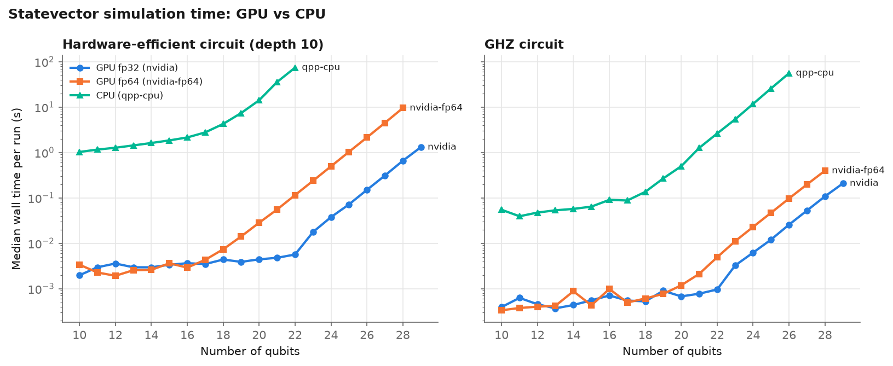
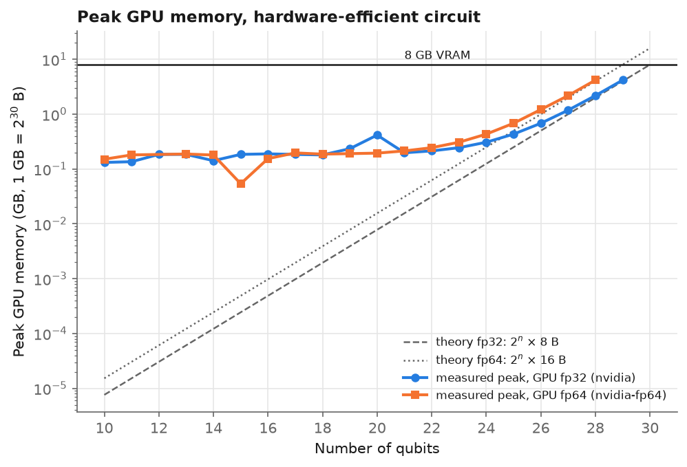
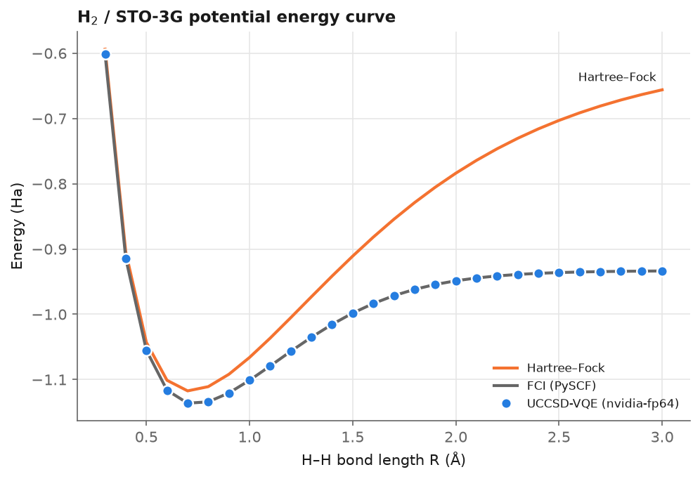
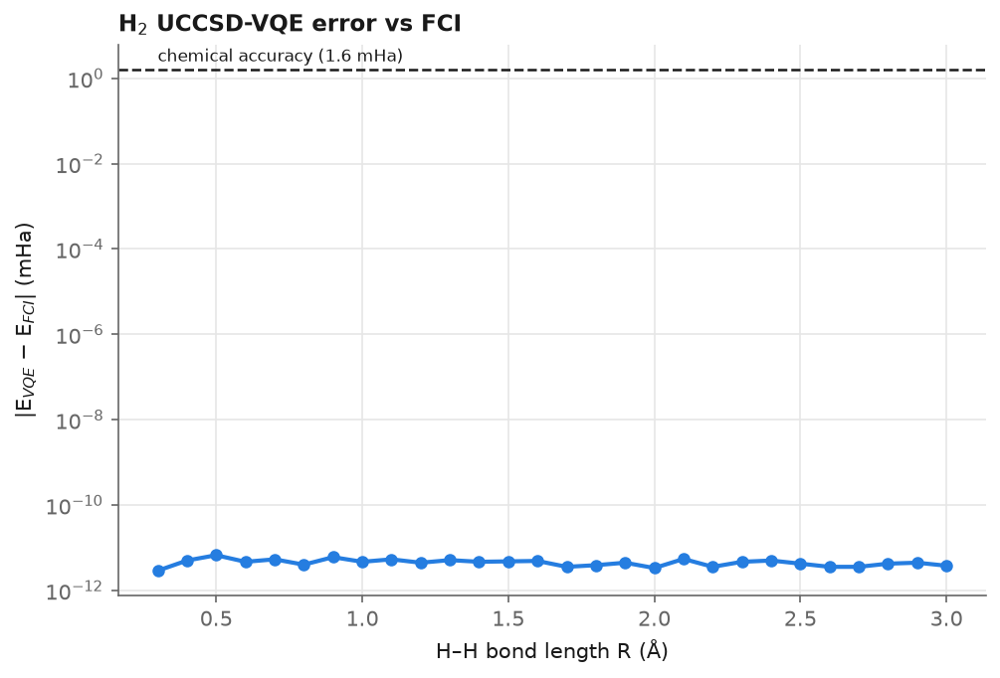

# GPU Quantum Simulation & VQE with NVIDIA CUDA-Q

Statevector simulation benchmarks and a UCCSD variational quantum eigensolver (VQE), run on an
8 GB laptop Blackwell GPU with NVIDIA CUDA-Q. The GPU simulates up to **29 qubits** in fp32
(28 in fp64), the hard ceiling for 8 GB of VRAM. A UCCSD-VQE reproduces the H₂ potential energy
curve to within **6.66e-12 mHa** of full configuration interaction (FCI) at all 28 bond
lengths, far inside chemical accuracy (1.6 mHa). Every number below is read from a CSV in
`results/` that was produced by the scripts in this repo.

## Hardware / software

| | |
|---|---|
| GPU | NVIDIA RTX PRO 2000 Blackwell Generation Laptop GPU (compute capability 12.0, sm_120) |
| VRAM | 8151 MiB (7.96 GiB), shared with the Windows desktop |
| Driver | 597.01 (Windows host driver, CUDA 13.2), used through WSL2 |
| CPU | Intel Core Ultra 7 255H, 16 threads visible to WSL |
| OS | Ubuntu 26.04.1 LTS on WSL2 (kernel 6.18.33.2-microsoft-standard-WSL2) |
| CUDA-Q | 0.17.0 (`cudaq` / `cuda-quantum-cu13` wheels) |
| Python | 3.14.4 |
| Chemistry | PySCF 2.15.1, OpenFermion 1.8.1, openfermionpyscf 0.5 |

## Results

### A. Statevector scaling: GPU vs CPU

Each point: 1 warm-up and 5 timed runs of `cudaq.observe(<Z on qubit 0>)` (the state stays on
the device), each size in its own subprocess. Circuits: a hardware-efficient layered circuit
(RY+RZ on every qubit, then a CNOT ladder; depth 10, fixed angles from seed 42) and GHZ.




| Key number (from `results/summary.csv`) | Value |
|---|---|
| Max qubits, GPU fp32 (`nvidia`) | **29**: hardware-efficient 1.305 s/run, GHZ 0.2081 s/run |
| Max qubits, GPU fp64 (`nvidia-fp64`) | **28**: hardware-efficient 9.522 s/run, GHZ 0.3965 s/run |
| Max qubits, CPU (`qpp-cpu`) | hardware-efficient **22** (sweep stopped there, see note); GHZ **26** (55.67 s/run) |
| Peak GPU memory at the max size | 4.183 GB (fp32, 29 q) and 4.183 GB (fp64, 28 q) |
| GPU fp32 vs CPU, hardware-efficient @ 22 qubits | 0.005643 s vs 73.98 s → **13111×** |
| GPU fp32 vs CPU, GHZ @ 26 qubits | 0.02563 s vs 55.67 s → **2172×** |
| fp32 / fp64 / CPU agreement of ⟨Z₀⟩, n = 10–20 | 22 of 22 points agree to 1e-4 (max difference 4.89e-07) |

How to read these:
- **The speedup is against CUDA-Q's `qpp-cpu` backend**, the reference CPU simulator shipped
  with CUDA-Q, not against an optimized CPU simulator. `qpp-cpu` costs about a second per
  hardware-efficient run even at 10 qubits, while the `nvidia` target fuses gates. Treat the
  ratio as "GPU target vs CUDA-Q's CPU target on this laptop", not as a general GPU/CPU ratio.
- **fp64 is much slower than fp32 at the same width**: at 28 qubits, 9.522 s vs 0.657 s for the
  hardware-efficient circuit. The fp64 state is only 2× larger, so most of the gap is
  arithmetic; laptop/workstation Blackwell parts have low FP64 throughput.
- **Peak memory** is the device-wide increase over the level before the run, polled with
  pynvml from the parent process (WSL2 has no per-process NVML accounting). Below about 22
  qubits it is just the ~0.18 GB CUDA context plus noise from the Windows desktop. Two
  sub-second fp64 runs were missed by the poller (12 qubits read 0.0, 15 read 0.054); the
  0.0 is left out of the log-scale plot.
- **No run failed**: every attempted size finished with status `OK`; no `OOM` or `TIMEOUT` rows.
- **Note: CPU hardware-efficient sweep stopped at 22 qubits.** CPU time doubles per qubit
  (73.98 s/run at 22), so 23–26 qubits would have added about an hour, with 25–26 projected to
  exceed the 300 s per-run limit. I chose to stop there. `make bench` runs the full 10–26
  range; the harness logs such sizes as `TIMEOUT` and keeps going.

### B. H₂ / STO-3G with UCCSD-VQE

4 qubits, 2 electrons, 3 UCCSD parameters (2 singles + 1 double). Optimized on `nvidia-fp64`
with L-BFGS-B and central finite-difference gradients (gtol 1e-8), falling back to COBYLA if
L-BFGS-B reports failure. Each of the 28 points (R = 0.30–3.00 Å) is started from the previous
point's optimum and from zero amplitudes; the lower energy is kept. Before the scan, the
script checks that VQE matches FCI at R = 0.7474 Å to 1e-5 Ha and aborts otherwise.




| Key number (from `results/summary.csv`) | Value |
|---|---|
| Points | 28 |
| Max \|E_VQE − E_FCI\| | **6.66e-12 mHa** |
| Mean \|E_VQE − E_FCI\| | 4.50e-12 mHa |
| All points below chemical accuracy (1.6 mHa) | True |

The errors sit at floating-point level, which is expected. In a minimal basis the H₂ ground
state lies in a two-determinant space that UCCSD spans exactly, and the simulation is exact
(no shot noise, no hardware noise). This checks that the whole pipeline (integrals → Jordan–Wigner →
`cudaq.SpinOperator` → HF state → UCCSD → optimizer) is correct; it is not a statement about
noisy quantum hardware.

### C. Bonus

**Beyond the statevector limit with MPS** (`results/mps.csv`, target `tensornet-mps`,
1000 shots). A GHZ state has bond dimension 2, so a matrix product state stores it exactly:

| Qubits | all-0 | all-1 | other | Wall time (s) |
|---|---|---|---|---|
| 30 | 494 | 506 | 0 | 0.591 |
| 35 | 492 | 508 | 0 | 0.148 |
| 40 | 505 | 495 | 0 | 0.181 |

This only works because GHZ has very little entanglement. A random deep circuit would need an
exponential bond dimension.

**LiH active space** (`results/lih_point.csv`): LiH / STO-3G at R = 1.6 Å, CAS(4e, 4o) → 8
qubits, 26 UCCSD parameters. VQE −7.8630611 Ha vs PySCF CASCI −7.8630611 Ha (HF −7.8618648 Ha);
\|error\| **9.01e-06 mHa**, 15 L-BFGS-B iterations, 23.3 s.

## Background

**Statevector simulation.** An n-qubit state is a vector of 2ⁿ complex amplitudes; every
gate updates the whole vector. Memory is 2ⁿ × 8 B in single precision (two float32 per
amplitude) or 2ⁿ × 16 B in double. Each extra qubit doubles both memory and time, which is the
straight-line growth on the log-scale plots once fixed overheads stop dominating (about 22
qubits on the GPU).

**Why 29 qubits is the ceiling on 8 GB.** 2²⁹ × 8 B = 4 GiB fits. The measured peak at 29
qubits is 4.183 GB: the 4 GiB statevector plus the CUDA context. 30 qubits would need
2³⁰ × 8 B = 8 GiB for the statevector alone, more than the 7.96 GiB the card reports, before
counting the CUDA context and the memory the Windows desktop already holds. In fp64 the
same arithmetic gives 2²⁸ × 16 B = 4 GiB, so the ceiling is 28. Going further needs more
GPUs (`nvidia-mgpu`) or a compressed representation such as MPS (section C), which only works
for low-entanglement states.

**VQE, UCCSD and chemical accuracy.** VQE prepares a parameterized state |ψ(θ)⟩ on the
(simulated) quantum computer, measures the energy ⟨ψ(θ)|H|ψ(θ)⟩, and lets a classical optimizer
minimize it. By the variational principle the minimum is an upper bound on the true ground
state energy. UCCSD (unitary coupled-cluster with single and double excitations) builds
|ψ(θ)⟩ by applying exponentials of excitation operators to the Hartree–Fock state. Spin
orbitals are interleaved (even = α, odd = β) in both OpenFermion and `cudaq.kernels.uccsd`,
so the HF state is X on qubits 0…n_e−1. *Chemical accuracy* is 1 kcal/mol ≈ 1.6 mHa, the
error below which computed reaction energies are useful to chemists.

## Reproduce

```bash
source ~/qenv/bin/activate            # Python 3.14 venv
pip install -r requirements.txt       # only when starting from a fresh venv
make bench   # GPU+CPU scaling sweep -> results/scaling.csv, correctness.csv (the CPU leg takes hours)
make vqe     # H2 scan              -> results/h2_pes.csv
make bonus   # MPS GHZ + LiH        -> results/mps.csv, results/lih_point.csv
make plots   # figures + results/summary.csv, from the CSVs only
make test    # pytest -q
make all     # all of the above
```

Without make, set `PYTHONPATH=src`, e.g. `PYTHONPATH=src python benchmarks/run_scaling.py --backends nvidia --max-qubits 24`.
`run_scaling.py` merges into an existing `scaling.csv` by (backend, circuit, n), so subsets
can be re-run. The committed `scaling.csv` was produced by three invocations:

```bash
python benchmarks/run_scaling.py                     # full sweep; stopped during CPU hardware-efficient, 23 qubits
python benchmarks/run_scaling.py --max-qubits 20     # all backends, n<=20 (re-measured; writes correctness.csv)
python benchmarks/run_scaling.py --backends qpp-cpu --circuits ghz --min-qubits 21
```

## Environment notes

- **Python 3.14 works with CUDA-Q 0.17.0.** No fallback to a Python 3.12 venv was needed, and
  there was no "no kernel image" error on sm_120, so CUDA-Q was not upgraded.
- **Removed the deprecated `pynvml` package from the venv.** It is a shim whose import hook has
  an incompatible `find_spec` signature that breaks cirq's lazy importer, so `import openfermion`
  failed. `import pynvml` still works through `nvidia-ml-py`, which is what `requirements.txt`
  pins. Do not install both.
- **`nvidia-fp64` is deprecated as a target name in CUDA-Q 0.17.** The code keeps the label but
  calls `cudaq.set_target("nvidia", option="fp64")` (same cuStateVec fp64 simulator).
- **Per-run timeout.** The child process arms `signal.alarm(300)` before each run; the default
  SIGALRM action kills it even inside the C++ simulator, and the parent logs `TIMEOUT`.

## Layout

```
src/gpuvqe/      circuits.py, hamiltonians.py, vqe.py, utils.py
benchmarks/      run_scaling.py, _single_run.py, run_mps.py
experiments/     h2_pes.py, lih_point.py
scripts/         make_plots.py
tests/           test_vqe.py
results/         CSVs + PNGs
```

## Résumé bullet

> Built a GPU quantum-simulation and VQE pipeline in NVIDIA CUDA-Q on an 8 GB Blackwell laptop
> GPU: simulated statevectors up to the 29-qubit memory ceiling (fp32; 28 in fp64), ran
> 13111× faster than CUDA-Q's CPU backend at 22 qubits, and reproduced the H₂ potential energy
> curve with UCCSD-VQE to within 6.66e-12 mHa of FCI at all 28 bond lengths (chemical accuracy:
> 1.6 mHa).
